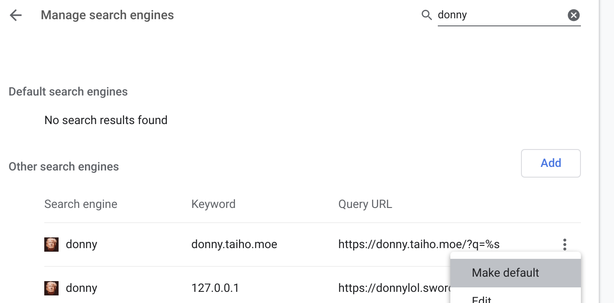
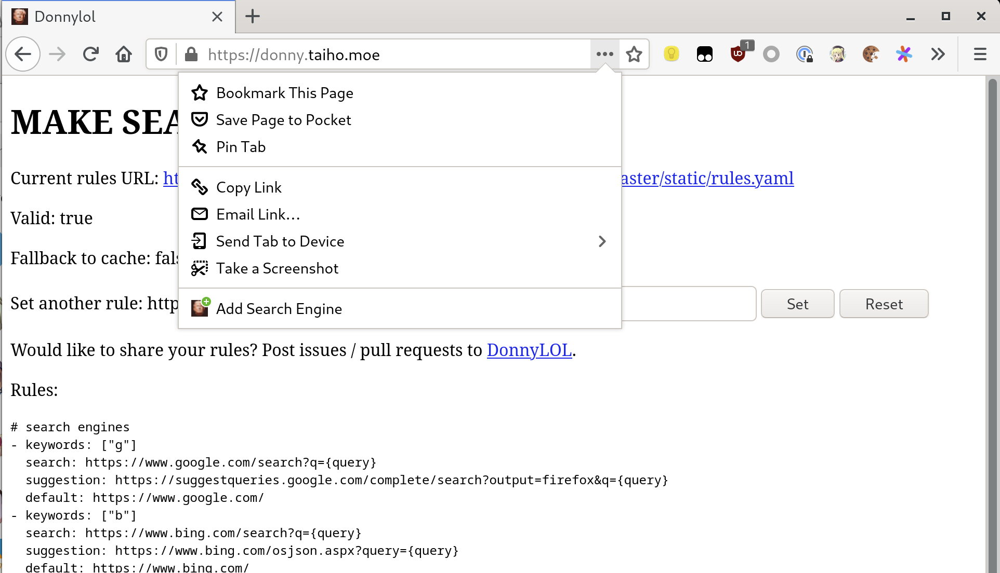
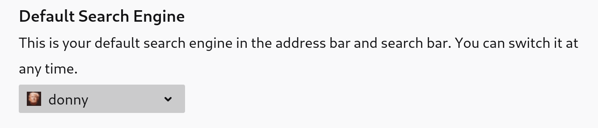

# Donny LOL

A search-engine shortcut service: add `https://donny.taiho.moe/?q=%s` as the browser's
default search engine, then type a keyword in front of the query:

```
g searching google
b searching bing
gi google image
wikija 東京        (Japanese Wikipedia; any wiki<lang>)
r/rust async       (search inside a subreddit)
BV1xx411c79H       (open a bilibili video)
!w tokyo           (DuckDuckGo bang)
anything else      (Google)
```

A keyword alone opens the site's home page (`g` -> https://www.google.com/).

## Using it

Add it as the default search engine:

* Chrome

  
* Firefox: open https://donny.taiho.moe/ and add "donny" from the address bar

  
  

The home page also lets you:

* use your own rules from a GitHub gist (cookies `github_user` and `gist_id`);
* use another favicon for the search engine (cookie `favicon_path`, URL-encoded base URL;
  `<base>/favicon.ico` and `<base>/favicon.jpg` are served).

## Rules

Rules are a YAML list, tried in order; the first match wins. Default rules:
[static/rules.yaml](static/rules.yaml).

```yaml
- keywords: ["g"]                     # first word of the query
  search: https://www.google.com/search?q={query}
  suggestion: https://suggestqueries.google.com/complete/search?client=firefox&q={query}
  default: https://www.google.com/    # used when there is nothing after the keyword
- match: "r/([A-Za-z0-9_\\.]+)"       # or a regex on the start of the query
  search: https://www.reddit.com/r/{1}/search?q={query}
  default: https://www.reddit.com/r/{1}/
- search: https://www.google.com/search?q={query}   # no keywords/match: catch-all
```

Placeholders: `{query}` (rest of the query, URL-encoded, spaces as `+`), `{keyword}`
(the keyword or the regex match), `{1}`, `{2}`, ... (regex groups). `suggestion` must
return the OpenSearch suggestion JSON (`["query", ["s1", "s2"], ...]`).

Supported YAML: block mappings and lists, `[..]`/`{..}`, quoted strings, `|`/`>` blocks,
comments; JSON also works. Anchors, aliases and tags are not supported (the file then
counts as invalid). Invalid or unreachable rules fall back to the last good copy in KV,
then to the default rules.

## Endpoints

| Path | |
| --- | --- |
| `/?q=...` | redirect page (HTML + JS, not a 302, so Chrome keeps the search engine) |
| `/` | home page: current rules URL, whether they are valid, settings |
| `/suggestion?q=...` | search suggestions (`application/x-suggestions+json`) |
| `/search-plugin.xml` | OpenSearch description |
| `/rules.json` | the active rules as JSON (used by the browser service worker) |
| `/favicon.ico`, `/favicon.jpg` | proxied from `static/` or `favicon_path` |
| `/sw.js`, `/sw.js.map` | browser service worker, proxied from `static/` |

Everything else is `404`. The worker never answers with a 5xx itself: upstream failures
give empty suggestions, the home page, or `404`.

## Deployment

The worker is a single file with no dependencies and no build step:
[src/worker.js](src/worker.js), in the classic service-worker format
(`addEventListener('fetch', ...)`), so no compatibility date is needed.

Cloudflare dashboard -> Workers -> `donnylol` -> Edit code -> replace everything with
`src/worker.js` -> Deploy. Route: `donny.taiho.moe/*`.

Binding (keep as is):

| Name | Type | |
| --- | --- | --- |
| `DONNY_RULES_CACHE` | KV namespace | last good copy of each rules file |

KV format: key = rules URL, value = the raw YAML text, metadata `{"refresh": <ms>}`,
`expirationTtl` 3 days. An entry is rewritten when the text changes or after `refresh`
(1 day). Rules files are also cached at Cloudflare's edge for 2 days.

Files under `static/` are fetched live from the `master` branch on GitHub
(`raw.githubusercontent.com`), so pushing changes to `static/rules.yaml` changes the
default rules immediately, without a deploy. `static/sw.js` is a prebuilt browser
service worker; its TypeScript source was removed with the webpack build and is in the
git history (`src/sw.ts`, `src/swHandler.ts` before the rewrite).

## Testing

```
node --test
```

Needs only Node.js (no `npm install`). `test/worker.test.mjs` loads `src/worker.js` as a
classic script in a `node:vm` context with mocked `fetch` and KV.
